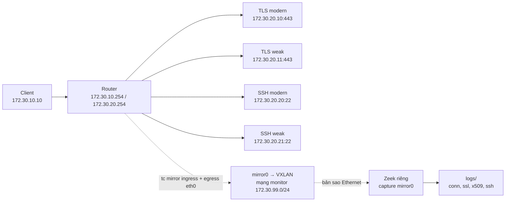

# Topic 4 — Mạng lab, Zeek và bảng sessions CSV

Thiết kế mở rộng dự kiến với firewall/router ảo, Nginx reverse proxy, Bastion và Web/App/DB nằm trong [TOPOLOGY.md](TOPOLOGY.md). Đây là kế hoạch triển khai; topology đang chạy vẫn là lab mô tả bên dưới.

Bản này bắt đầu lại từ phần mạng. Client kết nối TLS/SSH qua router, Zeek ghi metadata JSON, rồi `scripts/build_sessions.py` ghép log thành bảng CSV dễ đọc.

## Chạy nhanh: từ mạng lab đến CSV

Chạy các lệnh sau trong PowerShell, khi Docker Desktop đã bật Linux containers và máy đã có Python 3:

```powershell
cd F:\Master_projects\Topic4
docker compose up -d --build --wait
.\test-lab.ps1
python scripts/build_sessions.py
Import-Csv .\data\sessions.csv | Format-Table application_protocol,src_ip,dst_ip,tls_cipher,ssh_kex
```

`test-lab.ps1` tạo traffic thử nghiệm thật trong lab và restart Zeek để flush log. `build_sessions.py` đọc log có sẵn, không tạo traffic và không chạy model AI. Muốn CSV cập nhật sau lần thử mới, chạy lại script Python; hiện chưa có scheduler hay backend cập nhật tự động.

## Tình trạng hiện tại — 05/10/2026

Project đã có **bước 1: mạng lab và thu thập metadata**, cùng **bước 2: ghép log thành CSV**. Kiểm tra Docker ngày 05/10/2026 khi dựng lab cho thấy cả 7 services đang chạy; router và Zeek healthy. Zeek trong container là phiên bản **9.0.0**. Chỉ router và Zeek có healthcheck trong Compose, nên trạng thái running của các server không tự chứng minh dịch vụ đã negotiate thành công.

| Thành phần | Hiện đã có gì? |
| --- | --- |
| Mạng | Ba Docker bridge: clients, servers và monitor dành riêng cho bản sao traffic |
| TLS | Hai Nginx/OpenSSL servers: modern và weak |
| SSH | Hai OpenSSH servers: modern và weak |
| Sensor | Zeek ở namespace riêng, nhận traffic mirror trên mirror0 qua VXLAN |
| Log | Đã có dữ liệu trong conn, ssl, x509 và ssh logs |
| Bảng session | Script Python ghép các log và tạo `data/sessions.csv`, một dòng mỗi connection UID |
| Kiểm tra lab | `test-lab.ps1` đã chạy thành công ngày 05/10/2026 khi dựng bản mới |

**Chưa triển khai trong bản mới:** HMAC-token hóa, custom packet features, Rules, XGBoost, Isolation Forest, fusion, ATT&CK mapping, agent và dashboard. Đây là các bước phát triển tiếp theo. Mã nguồn/dataset của bản cũ nằm trong thư mục backup riêng, không được bản lab mới nạp.

## Mạng hoạt động thế nào?



Có 7 container: một client, một router, bốn test servers và một sensor Zeek. Router và Zeek có network namespace riêng. Router chuyển tiếp và source NAT traffic phía server; đồng thời sao chép ingress và egress của interface phía client (eth0). Vì vậy bản sao vẫn chứa IP nguồn/đích phía client trước source NAT hoặc sau khi reverse NAT. Mạng monitor chỉ kết nối router và sensor, không dùng Open vSwitch.

| Compose service | IP/port | Nhiệm vụ |
| --- | --- | --- |
| `client` | `172.30.10.10` | Tạo traffic bằng curl/SSH |
| `router` | `172.30.10.254`, `172.30.20.254`, `172.30.99.10` | Routing, firewall, NAT và gửi bản sao |
| `tls-modern` | `172.30.20.10:443` | TLS profile modern |
| `tls-weak` | `172.30.20.11:443` | TLS profile weak |
| `ssh-modern` | `172.30.20.20:22` | SSH profile baseline |
| `ssh-weak` | `172.30.20.21:22` | SSH profile alternate |
| `zeek` | `172.30.99.20` trên mạng monitor | Nhận bản sao và ghi metadata |

Router hiện là **Linux Alpine**, không phải vrnetlab. Nginx hiện là TLS test endpoint, chưa phải reverse proxy cho backend. Bastion, Web/App/DB và dashboard chưa được triển khai.

Luồng dữ liệu hiện tại là: **client tạo kết nối → router chuyển traffic → server trả lời → Zeek ghi metadata vào `logs/` → chạy `scripts/build_sessions.py` → `data/sessions.csv`**. Chạy script thủ công khi cần cập nhật bảng.

### Theo dõi luồng qua từng file

| Bước | File phụ trách | Điều xảy ra |
| --- | --- | --- |
| 1. Dựng lab | `compose.yaml` | Tạo 7 containers và 3 networks, gắn IP/interface, mount thư mục log |
| 2. Cho client đi đến server | `lab/client/entrypoint.sh`, `lab/router/entrypoint.sh` | Cấu hình route phía client; router thiết lập firewall/NAT và gọi script mirror |
| 3. Sao chép traffic | `lab/router/mirror.sh` | Mirror hai chiều của eth0, gửi bản sao qua VXLAN đến sensor |
| 4. Bắt bản sao | `zeek/entrypoint.sh` | Lưu lại log cũ, tạo interface nhận mirror0, khởi chạy Zeek |
| 5. Ghi metadata | `zeek/local.zeek` | Cho phép 4 log streams và ghi JSON, rotation mỗi phút |
| 6. Ghép session | `scripts/build_sessions.py` | Đọc conn/ssl/ssh/x509, nối dữ liệu thành một dòng mỗi conn UID |
| 7. Xem kết quả | `data/sessions.csv` | Snapshot metadata để xem bằng Excel/PowerShell, chưa có prediction hay nhãn attack |

Hai việc độc lập: routing chuyển **packet gốc** đến server; mirror chuyển **bản sao** đến Zeek. Zeek không nằm trên đường chuyển tiếp bắt buộc của request/response. Tuy vậy Compose hiện chờ cấu hình mirror của router đạt healthcheck trước khi khởi động các dịch vụ phụ thuộc.

## Mirror hoạt động thế nào?

1. `lab/router/mirror.sh` tạo interface VXLAN `mirror0` và hai bộ lọc `tc` trên `eth0`. Ingress dùng priority 10, egress dùng priority 20, mỗi chiều có đúng một mirror action.
2. `action mirred egress mirror dev mirror0` tạo bản sao packet. Packet gốc tiếp tục routing/firewall/NAT như bình thường; đây là mirror, không phải redirect.
3. Bản sao Ethernet được đóng gói VXLAN (VNI 42, UDP 4789) và gửi qua `eth2` của router đến Zeek trên mạng monitor. Mạng này có MTU 1600 để chứa overhead tunnel; `mirror0` dùng MTU 1500.
4. `zeek/entrypoint.sh` tạo đầu nhận VXLAN, giải đóng gói rồi chạy Zeek capture `mirror0`. Zeek không capture eth0 của router và không dùng `network_mode: service:router` nữa. Interface `mirror0` không có IPv4 address được cấu hình.

VXLAN được chọn vì phép thử trên kernel Docker Desktop/WSL hiện tại hỗ trợ VXLAN, nhưng không tạo được GRETAP. Bộ lọc dùng `u32` vì classifier `matchall` không hoạt động trong phép thử. Việc này không đòi hỏi router ảo vrnetlab.

Đường mirror vận chuyển bản sao đầy đủ của packet, gồm cả encrypted payload trong bộ nhớ; output của Zeek vẫn giới hạn metadata, không lưu payload/PCAP hay giải mã TLS. Mirror này chỉ bao phủ traffic đi qua eth0 phía client. Traffic giữa hai server trên cùng mạng servers không đi qua eth0, nên cần thêm điểm mirror nếu mở rộng topology để quan sát traffic đó.

Kiểm tra cấu hình và bộ đếm:

```powershell
docker compose exec -T router tc -s filter show dev eth0 ingress
docker compose exec -T router tc -s filter show dev eth0 egress
docker compose exec -T zeek ip -s link show mirror0
```

Sau khi tạo traffic, mỗi chiều có một action `Mirror to device mirror0`; counter `Sent ... pkt` và RX packets của sensor tăng. Restart Zeek tạo lại interface sensor nên RX counter được reset. Tài liệu lệnh: [tc-mirred](https://man7.org/linux/man-pages/man8/tc-mirred.8.html).

## Mỗi file dùng làm gì?

```text
Topic4/
├── compose.yaml         # Khai báo 7 container, IP và kết nối mạng
├── lab/
│   ├── client/          # Dockerfile + entrypoint.sh: công cụ curl/SSH và route
│   ├── router/          # Dockerfile, entrypoint.sh, mirror.sh: routing/NAT/mirror
│   ├── tls-server/      # Nginx/OpenSSL: Dockerfile, entrypoint, 2 file .conf
│   └── ssh-server/      # OpenSSH: Dockerfile, entrypoint, 2 file sshd_config.*
├── zeek/
│   ├── Dockerfile       # Base Zeek pin digest + iproute2 cho tunnel
│   ├── entrypoint.sh    # Giữ log cũ, tạo đầu nhận VXLAN, capture mirror0
│   └── local.zeek       # Bật JSON và chỉ cho ghi conn/ssl/x509/ssh
├── logs/                # Zeek tạo log tại đây; .gitkeep giữ thư mục rỗng
├── scripts/
│   └── build_sessions.py # Ghép JSON logs theo UID, xuất bảng CSV
├── data/
│   └── sessions.csv      # Bảng session được script tạo từ log thực tế
├── test-lab.ps1         # Sinh traffic và kiểm tra cả bốn endpoint trong log
├── .gitignore           # Không đưa log thực nghiệm vào Git
├── TOPOLOGY.md          # Thiết kế mở rộng dự kiến, không phải topology đang chạy
└── README.md
```

Mỗi `Dockerfile` mô tả cách tạo image. Mỗi `entrypoint.sh` chạy khi container khởi động. TLS dùng `modern.conf` hoặc `alternate.conf`; SSH dùng `sshd_config.baseline` hoặc `sshd_config.alternate`. Trong Compose, tên `weak` chọn profile `alternate`.

## File `zeek/local.zeek` làm gì?

File này được nạp bởi `zeek/entrypoint.sh` với lệnh `zeek -C -i mirror0 /config/local.zeek`. Thư mục `zeek/` trên máy được mount read-only vào `/config`; thư mục `logs/` được mount vào `/logs` để nhận dữ liệu sensor ghi. Entry point được COPY vào image khi build, nên sửa entrypoint cần build lại service Zeek.

| Cấu hình | Tác dụng |
| --- | --- |
| `@load policy/tuning/json-logs` | Mỗi dòng log là một JSON object |
| `allowed_logs` | Khai báo bốn loại record được ghi: Conn, SSL, X509, SSH |
| `hook Log::log_stream_policy` | Ngăn ghi record thuộc log stream ngoài danh sách trên |
| `Log::default_rotation_interval = 1min` | Xoay vòng log mỗi phút |

`local.zeek` hiện thiết lập cách ghi metadata; chưa có custom feature aggregation hay detection rules. Dòng comment cuối file mô tả việc không cấu hình extraction/PCAP/decryption; comment tự nó không thực thi thao tác tắt tính năng. `-C` trong command bỏ qua kiểm tra checksum, phục vụ capture trên mạng ảo.

## 1. Khởi động

Cần Docker Desktop chạy Linux containers. Mở PowerShell:

```powershell
cd F:\Master_projects\Topic4
docker compose up -d --build --wait
docker compose ps
```

Kết quả mong đợi: 7 services đang chạy, router và Zeek có trạng thái healthy. Phiên bản Compose phải hỗ trợ `interface_name`.

## 2. Tạo traffic và xem phản hồi

TLS modern:

```powershell
docker compose exec -T client curl -sk --tls-max 1.2 https://172.30.20.10/
```

TLS weak:

```powershell
docker compose exec -T client curl -sk --tls-max 1.2 --ciphers 'AES128-SHA:@SECLEVEL=0' https://172.30.20.11/
```

Mỗi lệnh trả JSON chứa profile và `status: ok`. `-k` chấp nhận chứng chỉ self-signed của lab. Dùng TLS 1.2 ở bước này để sensor đọc được certificate handshake; TLS 1.3 mã hóa phần certificate.

SSH modern:

```powershell
docker compose exec client ssh -o StrictHostKeyChecking=no labuser@172.30.20.20
```

Tài khoản thử nghiệm: `labuser`, mật khẩu `topic4-lab-only`. Gõ `exit` để kết thúc SSH.

## 3. Kiểm tra tự động

```powershell
.\test-lab.ps1
```

Script kiểm tra router và sensor có namespace riêng, mỗi chiều có đúng một mirror action; gửi hai TLS requests, mở hai SSH handshakes bằng chế độ không nhập mật khẩu, kiểm tra sensor RX packets, rồi restart Zeek để flush connection logs. SSH bị từ chối đăng nhập là kết quả dự kiến của kiểm tra handshake; script không kiểm tra đăng nhập thành công. Restart Zeek làm gián đoạn capture ngắn, chỉ dùng lúc test lab.

## 4. Đọc log

```powershell
Get-ChildItem .\logs
Get-Content .\logs\conn*.log | Select-Object -Last 3
Get-Content .\logs\ssl*.log | Select-Object -Last 3
Get-Content .\logs\ssh*.log | Select-Object -Last 3
```

| Log | Bạn xem được gì? |
| --- | --- |
| `conn*.log` | IP/port nguồn–đích, protocol, thời gian, số byte/packet |
| `ssl*.log` | TLS version, cipher, thông tin handshake |
| `x509*.log` | Metadata certificate khi sensor quan sát được |
| `ssh*.log` | SSH banner và thuật toán handshake quan sát được |

Zeek rotate log mỗi phút. Một số record chỉ xuất hiện khi connection kết thúc hoặc timeout; log không phải lúc nào cũng có ngay sau khi chạy curl.

**Vì sao có file có ngày và file không có ngày?** `conn.log` là tên cơ bản dùng cho log hiện hành; `ssl.2026-10-05-09-26-31.log` là file được đặt tên kèm timestamp khi xoay vòng/đóng log. Restart sensor cũng có thể tạo ra sự khác nhau giữa các file được đóng và các file tên cơ bản còn trong thư mục. Đừng chỉ dựa vào tên không có ngày để kết luận file đang được ghi: file đó có thể còn lại từ lần chạy trước. Dùng pattern `conn*.log`, `ssl*.log`, `x509*.log`, `ssh*.log` để đọc cả hai kiểu tên.

Trước mỗi lần khởi động sensor, `zeek/entrypoint.sh` chuyển các file tên cơ bản có dữ liệu từ lần chạy trước sang tên có timestamp UTC và hậu tố ngẫu nhiên. Việc này tránh ghi đè conn/ssh logs khi restart; script CSV đọc được các file lưu trữ đó bằng cùng wildcard. Những record đã bị ghi đè trước khi bổ sung cơ chế này không được khôi phục tự động.

Payload logging OFF, không dump PCAP, không TLS decryption. Raw metadata vẫn chứa IP lab. Các server weak chỉ dùng trong lab; Compose không publish cổng dịch vụ ra host. Client network có thể ra ngoài qua Docker, nên đây không phải môi trường air-gap.

## 5. Ghép log thành CSV

Cần Python 3, không cần cài package. Chạy từ project root:

```powershell
python scripts/build_sessions.py
Import-Csv .\data\sessions.csv | Format-Table application_protocol,dst_ip,tls_version,tls_cipher,ssh_kex
```

Mỗi UID trong `conn*.log` trở thành một dòng. Script đọc cả file cơ bản và file có timestamp, loại record trùng UID rồi sắp theo thời gian bắt đầu. `ssl*.log` và `ssh*.log` được nối qua `uid`; `x509*.log` nối qua fingerprint đầu tiên của `cert_chain_fps` trong TLS log. Record handshake chưa có `conn` tương ứng chưa được xuất, nên chạy lại khi Zeek đã ghi connection record.

Các nhóm cột:

CSV hiện có **32 cột**, lấy từ log Zeek hiện tại; chưa phải schema NF-UQ v2. Không có các trường packet-level như TTL, TCP flags, cửa sổ TCP hay retransmission vì bản mới chưa triển khai custom analyzer.

| Nhóm | Cột/thông tin |
| --- | --- |
| Session | UID, Unix timestamp, UTC timestamp, application protocol |
| Kết nối | IP/port nguồn–đích, transport protocol, duration, byte/packet theo hướng nguồn–đích, connection state |
| TLS | Version, cipher, curve, established, resumed |
| SSH | Version, client/server banner, KEX, cipher, MAC, host-key algorithm, số auth attempts Zeek báo cáo |
| Certificate | Key type, key bits, signature algorithm, tổng thời hạn hiệu lực theo ngày |

`src_bytes`/`dst_bytes` lấy từ `orig_bytes`/`resp_bytes` của conn log; không phải tổng IP-layer bytes. `cert_validity_days` là toàn bộ thời hạn hiệu lực certificate, không phải số ngày còn lại. Trường không quan sát được để ô trống; giá trị 0/False được giữ nguyên. Script không suy ra attack label từ endpoint weak và không tạo dữ liệu giả.

CSV là snapshot: mỗi lần chạy thành công thay file cũ, không append. CSV hiện giữ IP lab thô; HMAC sẽ là bước riêng. File được ghi UTF-8 BOM để Excel trên Windows đọc được. Nếu JSON chưa ghi xong, script báo file/dòng lỗi; đợi rồi chạy lại. Raw logs được giữ nguyên.

CSV chứa mọi connection có trong `conn*.log`, không chỉ TLS/SSH. Vì vậy có thể gặp dòng không có thông tin handshake hoặc traffic nền như ICMPv6. Ô TLS/SSH/certificate trống có nghĩa là không có field tương ứng để ghép; không tự động có nghĩa là lỗi hay tấn công. Endpoint `weak` cũng không tự động trở thành attack label.

Có thể chọn đường dẫn khác:

```powershell
python scripts/build_sessions.py --logs logs --output data/sessions.csv
```

Kiểm tra lần đầu ngày 05/10/2026: script tạo 4 dòng từ log thật (2 TLS, 2 SSH), giữ đúng cipher/KEX và key length của hai certificate. Đã kiểm tra thêm record trùng UID, ô thiếu dữ liệu, số 0/False và xử lý JSON lỗi bằng fixture trong thư mục tạm; fixture không được đưa vào CSV lab.

## Dừng và bước tiếp theo

```powershell
docker compose down
```

Container/network được gỡ; `logs/` được giữ. Image build cache vẫn còn để khởi động lại nhanh.

Bước tiếp theo là đối chiếu các dòng CSV với raw logs, rồi thêm Rules kiểm tra TLS/SSH policy. XGBoost L3/L4 và Isolation Forest TLS/SSH sẽ được xây dựng sau khi có dữ liệu và nhãn phù hợp.

Hướng detector dự kiến vẫn là ba nhánh riêng: Rules kiểm tra policy xác định; XGBoost phân tích hành vi L3/L4; Isolation Forest học baseline TLS/SSH benign. Hai nhánh ML độc lập, chỉ kết hợp bằng chứng ở bước fusion sau này. Chưa có nhánh nào trong ba nhánh đó chạy trong bản hiện tại.

## Khi chưa thấy log hoặc CSV mới

| Hiện tượng | Kiểm tra/cách xử lý |
| --- | --- |
| Container chưa chạy | `docker compose ps`; xem lỗi bằng `docker compose logs router zeek` |
| Không có metadata mới | Chạy `test-lab.ps1`; kiểm tra bộ đếm tc và RX mirror0 theo mục Mirror |
| Có ssl/ssh nhưng chưa có dòng CSV | Chờ conn record được ghi sau khi kết nối đóng/timeout; chạy lại script Python |
| CSV không đổi sau khi tạo traffic | CSV không tự cập nhật; chạy `python scripts/build_sessions.py` |
| Certificate trống khi dùng TLS 1.3 | Certificate handshake được mã hóa; không suy ra thông tin sensor không quan sát được |
| Excel đang mở CSV, script báo không thể ghi file | Đóng file trong Excel rồi chạy lại script |

Sửa `zeek/local.zeek` thì restart Zeek để nạp cấu hình. Sửa Dockerfile hoặc entrypoint đã COPY vào image thì build lại service tương ứng. Không cần xóa raw logs để áp dụng cấu hình mới.

## Các kiểm tra đã thực hiện

Đã chạy `test-lab.ps1` thành công ngày 2026-10-05: cả bốn endpoint có metadata mới trong conn/ssl/ssh; log X.509 cũng có certificate từ traffic TLS test.

Đã kiểm tra thêm sau cấu hình mirror ngày 05/10/2026: namespace router/sensor khác nhau, mỗi chiều eth0 có một mirror action và sensor nhận packet. Phép thử đối chứng tạm tắt mirror vẫn có HTTPS response thành công, nhưng không có conn record của kết nối thử trên Zeek; sau đó đã khôi phục mirror. Đây là phép kiểm tra thực hiện trong lần cấu hình, không tự chạy trong `test-lab.ps1`.

Bản project cũ được lưu riêng tại `F:\Master_projects\Topic4-backup-20261005`, bao gồm dataset, khóa và kết quả cũ. Chỉ các file dựng mạng cơ bản đã được tái sử dụng trong `lab/`.
