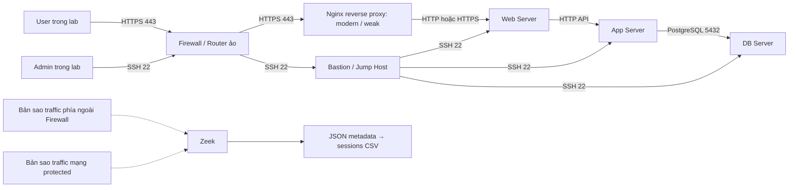

# Topology đích — Reverse Proxy, Bastion và Zeek

Đây là thiết kế dự kiến, chưa phải topology đang chạy. Lab hiện tại vẫn dùng router Linux trong compose.yaml.

## Luồng dịch vụ và quản trị



Internet trong sơ đồ được mô phỏng bằng client container; không cần mở cổng lab ra Internet thật. Admin có một địa chỉ riêng để phân biệt traffic quản trị với traffic người dùng.

## Vai trò các thành phần

| Thành phần | Nhiệm vụ |
| --- | --- |
| Firewall/router ảo | Routing và lọc kết nối giữa mạng ngoài, DMZ và protected network |
| Nginx reverse proxy | Kết thúc TLS của client và chuyển request đến Web Server |
| Bastion | Điểm vào SSH của Admin; cho phép kết nối tiếp đến protected servers |
| Web Server | Phục vụ web hoặc chuyển request API đến App Server |
| App Server | Xử lý API và truy cập DB |
| DB Server | PostgreSQL, không mở cho client ngoài |
| Zeek | Nhận bản sao packet, ghi metadata, không nằm trên đường chuyển tiếp chính |

Bastion cần hỗ trợ SSH forwarding để Admin sử dụng ProxyJump. Luồng này tạo kết nối SSH Admin→Bastion và một kết nối SSH qua tunnel tới server đích; metadata tại các điểm quan sát cần được diễn giải theo từng đoạn. Không lưu private key của Admin trên Bastion.

Ban đầu dùng một backend Web và một App. Chỉ gọi là load balancing khi Nginx thực sự phân phối request đến nhiều backend; reverse proxy một backend chưa thực hiện cân bằng tải.

## Phân đoạn mạng đề xuất

| Mạng | Subnet dự kiến | Nodes |
| --- | --- | --- |
| Outside | 172.30.10.0/24 | User .10, Admin .20, firewall .254 |
| DMZ | 172.30.20.0/24 | Proxy modern .10, proxy weak .11, Bastion .20, firewall .254 |
| Protected | 172.30.30.0/24 | Web .10, App .20, DB .30, firewall .254 |

Các địa chỉ trên là kế hoạch. IP hiện tại chưa được thay đổi. Hai TLS profiles modern/weak phục vụ thí nghiệm policy; profile weak chỉ dành cho lab.

## Kết nối được phép

| Nguồn | Đích | Port/mục đích |
| --- | --- | --- |
| User | Reverse proxy modern/weak | TCP 443 |
| Admin | Bastion | TCP 22 |
| Reverse proxy | Web | TCP 8080 HTTP hoặc 8443 HTTPS, chốt một phương án khi triển khai |
| Web | App | TCP 8000 API |
| App | DB | TCP 5432 |
| Bastion | Web, App, DB | TCP 22 |
| Các flow trên | Chiều phản hồi | Established/related |

Firewall chặn truy cập ngoài trực tiếp vào Web/App/DB và SSH trực tiếp vào protected servers. Web/App/DB nằm cùng subnet, vì vậy traffic giữa chúng không đi qua firewall; cần host firewall hoặc tách subnet nếu muốn kiểm soát east-west bằng firewall trung tâm. Docker network membership một mình không thay thế ACL.

## Mirror và phạm vi Zeek

Vrnetlab chạy VM router bên trong container; nó không tự tạo SPAN/TAP cho Zeek. Cần thêm cơ chế mirror trên virtual switch/link, hoặc tính năng mirror của thiết bị nếu image hỗ trợ.

Đề xuất quan sát hai vùng:
1. Link Outside→Firewall: thấy TLS User→Proxy và SSH Admin→Bastion.
2. Protected network: thấy Proxy→Web, Bastion→Web/App/DB và Web→App→DB.

Chọn một bản sao mỗi packet tại từng vùng; không mirror đồng thời ingress và egress của tất cả port khiến cùng packet bị nhân đôi. Có thể chạy hai Zeek workers/instances với log riêng cho mỗi vùng, rồi xử lý từng vùng bằng script hiện có:

```powershell
python scripts/build_sessions.py --logs logs/edge --output data/sessions-edge.csv
python scripts/build_sessions.py --logs logs/internal --output data/sessions-internal.csv
```

Các thư mục log theo vùng và workers trên chưa được tạo. Nếu hợp nhất chúng sau này, cần giữ sensor/vùng quan sát và provenance thay vì chỉ dựa trên UID.

Nếu proxy kết thúc TLS, Zeek phía ngoài thấy certificate/cipher của proxy. Proxy→Web dùng HTTP thì không có TLS metadata cho đoạn đó; dùng HTTPS thì đây là TLS session riêng. Không ghép hai đoạn chỉ bằng UID. TLS/SSH payload logging vẫn OFF, không PCAP persistence, không TLS decryption; HTTP/DB content không được lưu.

## Điều kiện triển khai vrnetlab

Kiểm tra ngày 05/10/2026: Docker Desktop WSL2 có device /dev/kvm. Chưa chạy phép thử khởi động QEMU/router VM, nên chưa xác nhận đầy đủ KVM sử dụng được.

Cần chọn hệ điều hành router/firewall và VM image tương ứng trước khi viết startup config: ví dụ MikroTik CHR, Cisco hoặc Juniper tùy image có sẵn. Image thiết bị chưa có trong danh sách Docker images đã kiểm tra. Tài nguyên và yêu cầu license phụ thuộc image được chọn.

Nếu dùng containerlab, build VM image với fork srl-labs/vrnetlab theo tài liệu chính thức:
https://containerlab.dev/manual/vrnetlab/

Bước triển khai tiếp theo: xác định image → thử boot VM → tạo networks và ACL → dựng Proxy/Bastion/protected servers → cấu hình mirror → kiểm tra traffic và metadata.
