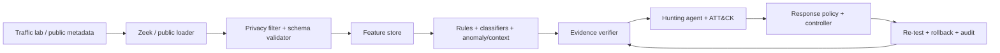

# Kế hoạch hoàn thiện Topic 04 — Metadata-Only TLS/SSH Threat Detection, Hunting & Response

Ngày lập kế hoạch: **06/10/2026**.

**Phạm vi hạ tầng đã chốt:** 7 container chính: web-frontend, backend, db, một Proxy đổi TLS profile, một Bastion dùng image pull, router Alpine NAT/IP forwarding và một Zeek. Client chỉ chạy tạm trong profile test. Web có ba thành phần riêng; các thành phần mạng vẫn mỗi loại một container.

Tài liệu này hướng dẫn hoàn thiện project từ Docker lab và Zeek logs đến detection, hunting agent, response có policy và bộ bằng chứng thực nghiệm. Cơ sở yêu cầu là **Topic_04_Agentic_Metadata_Only_TLS_SSH_Threat_Detection_Response_Revised.docx**, bản hướng dẫn đề tài sửa đổi tháng 09/2026, đặc biệt các mục 7, 11–19 và 21–23. Phạm vi hướng tới **cao học**.

- [README hiện tại](../README.md): cách chạy lab và tạo sessions CSV đã có.
- [TOPOLOGY.md](TOPOLOGY.md): topology 7 containers, Frontend/Backend/DB riêng và một Zeek.
- README này: thứ tự triển khai, artifact cần tạo và tiêu chí nghiệm thu.

**Các đường dẫn, module và CLI được ghi là “dự kiến” chưa tồn tại.** Không chạy các lệnh dự kiến trước khi triển khai module tương ứng. Tạo file kế hoạch không đồng nghĩa các tính năng trong kế hoạch đã hoàn thành.

## 1. Đích đến và nguyên tắc phạm vi

Demo cuối cần đi được toàn bộ chuỗi:



1. Detection chỉ dùng L3/L4 và metadata session/cryptographic handshake. Không dùng HTTP path/body/header values, SSH username/password/command/terminal, file contents hoặc decrypted payload làm feature.
2. Model/LLM không nhận private keys, TLS key-log, session secrets hoặc credentials. Key phục vụ endpoint lab được giữ trong vùng cấu hình riêng, không thuộc dataset/evidence/model context.
3. Đối chiếu negotiated algorithms với policy đã chọn. Tên service `weak` không phải bằng chứng một cuộc tấn công thực tế.
4. Anomaly score, fingerprint lạ và certificate đổi không tự động trở thành nhãn malicious.
5. Response controller là thành phần riêng có quyền hạn xác định; model/LLM chỉ đưa ra đề xuất theo schema.
6. Mọi label và high-severity finding phải có ground truth/evidence truy ngược được.
7. Chỉ chuyển sang bước phụ thuộc khi tiêu chí nghiệm thu của bước trước đã đạt.

## 2. Xuất phát điểm của repository

| Hạng mục | Hiện đã có | Cần làm tiếp |
| --- | --- | --- |
| Lab | 7 services chính theo TOPOLOGY.md | Scenario harness và dataset |
| Web | Cửa hàng Nook: sản phẩm, tìm/lọc, giỏ, đặt đơn và tồn kho; Frontend Nginx, Backend Python, PostgreSQL riêng; mỗi node có SSH | Scenario traffic và dữ liệu thử cần cho đề tài; dữ liệu mua hàng không vào ML/LLM |
| Proxy | Một proxy, 6 TLS/cert profiles; test strict client + Zeek + scenario manifest | Benign certificate renewal, TLS 1.3 visibility, missingness cases; manifest chưa là labeled training dataset |
| Bastion | Pull LinuxServer OpenSSH, key auth, ProxyJump tới Web | SSH behavior scenarios |
| Router | Alpine, NAT/IP forwarding/ACL và mirror | Response adapter có policy sau này |
| Zeek | Một sensor, sáu JSON logs; fingerprints, certificate/SPKI metadata, crypto rules và allowlist | Robustness, visibility/missingness experiments |
| Test | tests/test_lab.ps1 tạo client tạm, thử TLS/SSH/ACL, gỡ client | Scenario manifests và labels |
| CSV/dataset | build_sessions.py + custom generator, manifest join, final validator, typed CSV/Parquet và quarantine | Nhiều run/site, pseudonymization, split và validation nghiên cứu |
| Rules/ML/agent/response | TLS/SSH crypto rules và SSH burst/new-path đã có; ML/agent/response chưa triển khai | Các giai đoạn bên dưới |

Frontend→Backend→DB đi qua Protected subnet. Một Zeek nhận egress mirrors từ ba nodes để quan sát traffic nội bộ. Tiến độ hạ tầng đã đạt khác với việc hoàn thành phần nghiên cứu.

## 3. Thứ tự ưu tiên

| Mốc | Nội dung | Điều kiện chuyển mốc |
| --- | --- | --- |
| M0 — Lab tái lập | Baseline, scope/trust, routes/ACL/mirror | Smoke test, ACL tests, metadata coverage pass |
| M1 — Dataset v0 | Benign + scenarios, manifest, privacy/schema | Không field cấm, joins kiểm chứng được, nhãn có provenance |
| M2 — Detection v0 | Rules, XGBoost, Isolation Forest, calibration | Temporal/host holdout, metrics và evidence report |
| M3 — Hunting/response | Context graph, agent, policy, simulator | Evidence grounding và policy/rollback tests pass |
| M4 — Kết quả cao học | Fusion, robustness, public sources, demo | Ablation/generalization/response/privacy/reproducibility reports |

Ưu tiên hoàn thành M1 trước khi đầu tư dashboard hoặc mô hình DL lớn. Router Linux đáp ứng bước đầu; vrnetlab là nhánh tùy chọn nếu cần nghiên cứu thiết bị mạng. GNN/Transformer chỉ chọn khi dữ liệu và câu hỏi nghiên cứu phù hợp; calibrated fusion là hướng mở rộng cao học đã được đề tài nêu.

## 4. Cấu trúc repository

```text
project-root/
├─ compose.yaml                    # 7 services chính + client profile test
├─ README.md
├─ data/
│  ├─ public_loaders/               # Code loader, chưa triển khai
│  ├─ public/                       # Dataset công khai local, không commit
│  ├─ lab_metadata/                 # zeek/*.log JSON và sessions.csv
│  ├─ manifests/                    # Scenario ground truth/test metadata
│  └─ schemas/                      # Allowlist/validator, chưa triển khai
├─ sensors/
│  ├─ zeek/local.zeek               # Cấu hình sensor đang dùng
│  └─ suricata/                     # Thư mục chờ, chưa có sensor Suricata
├─ src/
│  ├─ features/build_sessions.py    # Ghép conn/ssl/x509/ssh thành CSV
│  ├─ models/                       # Chưa triển khai
│  ├─ hunting/                      # Chưa triển khai
│  ├─ agent/                        # Chưa triển khai
│  └─ response/                     # Chưa triển khai
├─ experiments/                    # Config/split/ablation/results sau này
├─ tests/                          # test_lab.ps1, test_shop.py, test_tls_profiles.py
├─ docker/                         # router, web, proxy, bastion, client, zeek
├─ scripts/                        # start-lab.ps1, trust-lab-hosts.ps1
└─ report/                         # TOPOLOGY, TLS_PROFILES, README_PLAN, STRUCTURE
```

Dataset lớn, raw logs, model binaries và secrets không commit vào Git. Các thư mục ML/agent đã tạo để sẵn sàng triển khai, chưa có tính năng ML/agent; không cần thêm containers cho từng module. Xem [STRUCTURE.md](STRUCTURE.md) để biết đường dẫn mới.

## 5. Giai đoạn 0 — Xác nhận baseline hiện có

1. Bật Docker Desktop Linux containers.
2. Chạy script start: khởi tạo keys bằng client tạm, sau đó dựng 7 services chính.
3. Kiểm tra 7 services healthy.
4. Chạy test: một client tạm thử frontend/backend/DB, modern/weak TLS lần lượt, SSH ProxyJump và ACL.
5. Test hoàn tất phải gỡ client, khôi phục profile; còn đúng 7 containers.
6. Xuất CSV và đối chiếu cipher/KEX với logs.
7. Ghi phiên bản Docker/Compose/Python, Git revision và test output vào report/environment.md dự kiến.

```powershell
Set-Location D:\NT2205.11.CH-Project
docker compose config --quiet
powershell -NoProfile -ExecutionPolicy Bypass -File .\scripts\start-lab.ps1
docker compose ps
powershell -NoProfile -ExecutionPolicy Bypass -File .\tests\test_lab.ps1
python src/features/build_sessions.py
Import-Csv .\data\lab_metadata\sessions.csv | Format-Table application_protocol,dst_ip,tls_version,tls_cipher,ssh_kex
```

Test restart Zeek để flush logs, chỉ dùng khi nghiệm thu. Không dùng test làm scheduler collection.

### Nghiệm thu

- [ ] Frontend có phản hồi và backend trả db_result=1.
- [ ] Modern/weak TLS metadata khác nhau trên cùng proxy.
- [ ] SSH qua Bastion tới Frontend/Backend/DB đăng nhập thành công bằng key.
- [ ] Client không truy cập trực tiếp Web/DB; PermitOpen chặn đích ngoài policy.
- [ ] Zeek có conn/ssl/ssh metadata mới và CSV khớp logs.
- [ ] Có environment/test evidence; chỉ 7 containers còn chạy sau test.

## 6. Giai đoạn 1 — Scope, trust boundaries và requirements

### Các bước

1. Viết `config/scope.yaml` dự kiến: CIDRs lab, IP/service roles, subnet classes, môi trường, action targets được phép. Bổ sung monitor subnet hiện tại `172.30.99.0/24` vào inventory; nó không phải traffic target của scenarios.
2. Viết `config/assets.yaml`: test-client/proxy/bastion/web-frontend/backend/db, criticality và allowed service relationships.
3. Mở rộng sơ đồ trust trong báo cáo: endpoints → sensor → privacy/feature store → model/agent → privileged response controller.
4. Viết `config/crypto_policy.yaml`: TLS versions/ciphers/key classes và SSH KEX/cipher/MAC/host-key classes được cho phép. Version policy và tách baseline hợp lệ khỏi deliberately weak fixtures.
5. Viết `config/retention.yaml`: thời gian giữ raw metadata, normalized features, manifests và action audit; cách xóa theo lịch, quyền truy cập, phạm vi áp dụng. Chốt con số theo dung lượng/nhu cầu tái lập và ghi lý do.
6. Lập `report/requirements_traceability.csv`: requirement → implementation → test → evidence path.

| Requirement đề tài | Artifact triển khai dự kiến | Bằng chứng tối thiểu |
| --- | --- | --- |
| SR-01, CR-06 | Schema/denylist, privacy filter | Validator reject field L7/secrets |
| SR-02 | Session IDs, timestamps, sensor IDs | Join fixture và clock/window checks |
| SR-03, CR-01/04 | Crypto policy + rules | Policy tests, negotiated metadata |
| SR-04 | Threshold/calibration config | Validation report, reason codes |
| SR-05 | Evidence verifier + ATT&CK mapping | Finding→events→analytic rationale |
| SR-06/07 | Scope guard + response controller | Deny tests, approval record khi áp dụng |
| SR-08 | Versioned splits | Temporal/device/source holdout results |
| SR-09, CR-03 | Feature masks + fallback | Missingness tests, uncertainty report |
| CR-02/05 | Cert/fingerprint continuity | Benign drift và substitution fixtures |

### Nghiệm thu

- [ ] Mỗi scenario có requirement, observable và giới hạn suy luận.
- [ ] Scope/data/action policy có version; tests không target mạng ngoài.
- [ ] Có giải thích rõ “metadata-only” ở sensor output, dataset và model/LLM context.

## 7. Giai đoạn 2 — Mạng Docker với Web tách ba thành phần

Dùng topology trong TOPOLOGY.md: 7 containers chính. Chỉ Web được tách, giữ một Proxy/Bastion/Router/Zeek.

### Các bước kiểm tra và hoàn thiện

1. Frontend tại 172.30.30.10:8080, Backend tại 172.30.30.20:8000, DB tại 172.30.30.30:5432; mỗi node có SSH 22.
2. Giữ một proxy 172.30.20.10:443; đổi TLS_PROFILE modern/weak tuần tự.
3. Bastion pull image LinuxServer OpenSSH tại 172.30.20.20:2222; chỉ forward SSH tới ba nodes.
4. Router Alpine có Outside/DMZ/Protected/Monitor interfaces, IP forwarding, NAT và ACL.
5. Client tạm 172.30.10.10 dùng TLS và SSH; không thêm User/Admin thường trực.
6. Frontend→Backend→DB cùng subnet: host INPUT/OUTPUT firewall giới hạn source/destination/port.
7. Router mirror Outside hai chiều, Protected chỉ egress; ba nodes mirror Protected egress. Một Zeek nhận tất cả qua VXLAN VNI 42.
8. Monitor interfaces .99.31/.32/.33 chỉ gửi bản sao tới Zeek .99.20; chặn application traffic qua Monitor.
9. Lưu NAT interpretation: các flows DMZ→Protected có nguồn .30.254; các flows Frontend→Backend→DB giữ IP nguồn thật.
10. Kiểm tra sensor loss/lag/coverage dưới tải; không coi interface counter bằng 0 là zero end-to-end loss.
11. Giữ DB data volume khi thay đổi image/config; không dùng down -v để chỉ áp dụng code mới.

| Flow | Kết quả |
| --- | --- |
| Client → Proxy 443 | Allow |
| Client → Bastion 2222 | Allow |
| Client → Frontend/Backend/DB trực tiếp | Deny |
| Proxy → Frontend 8080 | Allow |
| Frontend → Backend 8000 | Allow |
| Backend → DB 5432 | Allow |
| Bastion → Frontend/Backend/DB 22 | Allow |
| Frontend → DB trực tiếp | Deny |
| Application traffic qua Monitor | Deny |

### Nghiệm thu

- [ ] tests/test_lab.ps1 pass và client tạm được gỡ.
- [ ] Đúng 7 containers chính, không có Web container gom chung.
- [ ] HTTPS trả frontend và API db_result=1.
- [ ] ProxyJump tới cả ba nodes thành công.
- [ ] Zeek conn logs có bytes hai chiều của Frontend→Backend và Backend→DB.
- [ ] Có coverage/NAT explanation; chỉ publish Proxy tại `127.0.0.1:8443` để mở UI. Sinh TLS metadata qua client lab; truy cập UI từ host vào Proxy trực tiếp.

## 8. Giai đoạn 3 — Privacy, ingestion và schema validation

### Các bước

1. Giữ `build_sessions.py` làm baseline; thêm normalizer riêng để dễ đối chiếu trước/sau transform.
2. Xác định `session_id` nội bộ từ sensor identity + capture/run provenance + Zeek UID. Lab có một sensor; giữ provenance để phân biệt các lần capture/replay, không nối sessions chỉ vì UID của các nguồn khác nhau trùng nhau.
3. Lưu timestamp UTC, source file/record reference, sensor/version và `ingested_at`; ghi đồng bộ clock và độ lệch đo được khi dùng VM.
4. HMAC-token hóa IP/host/domain cần giữ continuity. Dùng keyed HMAC với domain separation, `token_key_version`; key nằm ngoài dataset/repo/LLM. Giữ token ổn định trong phạm vi experiment để temporal/graph joins hoạt động.
5. Raw SNI/SAN nếu có phải drop/tokenize trước feature store. IP thô được giữ ở vùng raw lab hạn chế truy cập, không ở production-like training artifact.
6. Tạo strict schema: field name, type, units, enum/range, nullable, source, observable condition và feature version. Default reject unknown fields; kiểm tra cả nested objects và metadata attachments.
7. Tạo deny fixtures chứa HTTP path/header/body, SSH command/user/password, secret/key-log/file contents; validator phải fail. Dùng dữ liệu giả cho fixtures, không dùng secrets thật.
8. Audit output ngoài Zeek: Nginx access logs thường có request path; vô hiệu hóa access log cho metadata-only collection hoặc tách khỏi pipeline và không đưa vào artifact/LLM. Tương tự, auth/app/DB logs không tự động được ingest. Output của test harness cũng cần được kiểm tra trước khi đưa vào report bundle.
9. Viết retention cleanup có dry-run, scope chính xác và audit. Không xóa volume key/cấu hình khi chỉ cần dọn telemetry.
10. Trước mọi training run, bắt buộc validator pass; ghi schema checksum và validation report.

### Feature groups ban đầu

| Nhóm | Bổ sung ưu tiên | Lưu ý |
| --- | --- | --- |
| L3/L4 | Host tokens, roles, duration, packets/bytes, conn_state, service/direction | Units rõ; orig_bytes không đồng nghĩa IP bytes |
| TLS | Version, cipher class, curve/group khi có, established, resumed | Cipher TLS 1.3 không tự xác định KEX/authentication |
| Certificate | Cert/SPKI token, key/sig class, validity status tại session, chain length | cert fingerprint và SPKI fingerprint khác nhau; không suy SPKI từ cert hash |
| SSH | KEX/cipher/MAC/host-key class, software family, session outcome khi quan sát được | Auth attempts/outcome do sensor suy đoán có giới hạn; không chứng minh password spraying |
| Fingerprints | JA4/JA3 và HASSH/JA4SSH nếu analyzer hỗ trợ | Chốt package/version, missing mask; không tự tạo fingerprint giả |
| Context | Rate/fan-out/new edge/baseline prevalence theo cửa sổ | Chỉ dùng dữ liệu có trước decision time |

Không yêu cầu điền đủ mọi cột trong schema gợi ý của DOCX. Trường chưa được analyzer thu thì để missing cùng availability mask, hoặc hoãn feature đó. Không dùng giá trị 0 thay missing và không suy ra hidden SNI/certificate của TLS 1.3.

### Nghiệm thu

- [ ] Dataset rejects unknown/prohibited fields và secrets fixtures.
- [ ] Token ổn định đúng key version, có kiểm tra joins và reverse leakage.
- [ ] Final feature store không có raw SNI/SAN/IP, certificate DER hoặc L7 content.
- [ ] Có field dictionary, schema/version/checksum và privacy report.

## 9. Giai đoạn 4 — Scenario harness và dataset lab có nhãn

### Manifest dự kiến

Tạo `data/manifests/scenario_manifest.csv`, mỗi dòng là một lần chạy scenario:

```text
run_id,scenario_id,scenario_version,seed,ts_start_utc,ts_end_utc,src_role,dst_role,src_host_token,dst_host_token,target_service,expected_behavior,ground_truth_source,config_hash,label_version
```

Session membership lưu ở bảng riêng `scenario_sessions.csv` với `run_id,session_id,label,match_method,match_confidence`. Không lưu list session không giới hạn trong một ô CSV. Nếu manifest gốc cần IP cho orchestration, giữ riêng trong vùng lab restricted và xuất bản tokenized view.

### Các bước cho mỗi scenario

1. Chuẩn bị endpoint/config; lưu hash cấu hình không chứa secret và baseline trước thay đổi.
2. Kiểm tra target nằm trong scope; đặt số kết nối tối đa, rate cap, timeout và stop condition trong config.
3. Ghi start time; chạy traffic với seed/schedule; ghi end time và result trạng thái.
4. Chờ collector hoàn tất record theo close/timeout/rotation; không restart Zeek định kỳ trong collection dài.
5. Normalize, validate và join manifest qua time window + source/target role/token + session evidence.
6. Nếu nhiều scenarios chồng lấn tạo ambiguous label, loại khỏi supervised set hoặc giữ ambiguous flag để review; không chọn nhãn tùy tiện.
7. Revert endpoint/routing/crypto changes; xác nhận baseline được khôi phục.
8. Lặp lại với thời điểm, client, software và traffic mix khác nhau; đặt số lần/số session trong experiment config.

| ID | Scenario | Ground truth / mục đích |
| --- | --- | --- |
| B01 | TLS normal, gồm TLS 1.2 và 1.3 | Known client/service; baseline fingerprint và metadata availability |
| B02 | SSH administration thành công | Allowed source→Frontend/Backend/DB qua Bastion; xác thực bằng key |
| B03 | Certificate renewal có kế hoạch | Benign cert/SPKI change; chống FP continuity |
| B04 | Resumption/reconnect | Normal session-rate và resumed behavior |
| B05 | Client software upgrade | Benign fingerprint drift |
| A01 | Weak TLS profile | `tls_policy_violation` từ negotiation + policy/config |
| A02 | Self-signed/expired/unexpected certificate | `cert_identity_anomaly`; self-signed chỉ bất thường so với policy đã chọn |
| A03 | Authorized interception fixture | Route + test CA/cert change; không dùng credentials thật |
| A04 | Periodic TLS beacon simulation | Schedule/endpoint ground truth; chứng minh pattern, không chứng minh malware |
| A05 | Repeated short/failed SSH attempts | Rate/window evidence; `ssh_bruteforce_behavior` theo harness |
| A06 | Legacy SSH algorithms | `ssh_crypto_policy_violation` từ negotiated KEX/cipher/MAC |
| A07 | New SSH path tới nhiều hosts | Graph/schedule manifest; anomaly với authorized baseline |
| A08 | Bounded scan/burst | Source/ports/window manifest; đo flow context |

### Tránh label leakage

- Chạy cả benign và suspicious behavior từ nhiều hosts; không để chỉ một IP/software đại diện attack.
- Không đưa scenario ID, label, ground_truth_source, service name `weak`, file name hoặc run ID vào feature vector.
- Group những session thuộc cùng scenario run; không để cùng run xuất hiện ở train và test.
- Background traffic ngoài window không tự được gán benign nếu chưa có evidence.
- Tách policy violation, suspicious behavior và confirmed maliciousness thành các khái niệm có reason codes.

### Nghiệm thu

- [ ] Có benign maintenance/drift và controlled suspicious fixtures.
- [ ] Label truy được tới run/config/schedule và session membership.
- [ ] Có đếm unmatched/ambiguous sessions, class distribution và sample audit.
- [ ] Dataset v0 qua privacy validator và có checksums.

## 10. Giai đoạn 5 — Public datasets và split phục vụ cao học

### Các bước

1. Lập dataset matrix: source/license/version/download checksum, format, features, label meanings, timestamp availability và intended experiment.
2. Bắt đầu bằng subset NF-UQ-NIDS-v2 cho L3/L4 classification; thêm IoT-23 light hoặc CTU-13 cho behavior/context. Bổ sung CESNET-TLS-Year22 khi làm TLS representation/drift; đáp ứng phạm vi ≥2 public sources + lab của đề tài cao học.
3. Chọn subset theo cấu hình cố định, seed và source/class distribution; tải metadata/CSV khi đủ, không tải PCAP chỉ để tăng số artifact.
4. Viết loader từng nguồn, giữ original provenance nhưng không dùng nó làm feature phân loại.
5. Audit và normalize units/types/missingness; loại fields chứa L7 hoặc identifiers không cần thiết.
6. Lập feature compatibility matrix. CSV hiện tại có 32 cột không tương đương 43 NetFlow features; chọn common feature subset hoặc xây analyzer thật cho feature thiếu và đánh giá lại domain shift.
7. Giữ L3/L4 supervised branch và lab TLS/SSH anomaly branch độc lập khi dữ liệu không có paired session. Không join public flow và lab handshake để tạo session giả.
8. CESNET service labels phục vụ service/representation analysis; không coi là attack labels.
9. Persist train/validation/test membership và hash để mọi model dùng cùng split.

| Split | Cách làm | Chống leakage |
| --- | --- | --- |
| Temporal | Train sớm, validation giữa, test muộn | Không window chồng lấn; purge khoảng biên phù hợp context horizon |
| Host/device | Giữ một client/server family ngoài train | Không fit encoders/baseline bằng host test |
| Fingerprint/software | Hold out version/family | Không random chia session cùng software run |
| Unseen attack | Bỏ một attack family khỏi supervised train | Không tune threshold trên held-out attacks |
| Cross-source/site | Train source A, test B | Deduplicate nguồn thành phần của aggregate dataset |
| Missing features | Dedicated masked test set | Ghi mask condition; không gọi mask test là ECH deployment thật |

Nếu public source không có timestamp đủ tin cậy, dùng source/device holdout và ghi limitation; không tạo timestamp giả để tuyên bố temporal split. NF-UQ aggregate có các nguồn thành phần: không train aggregate rồi test lại chính phần đã có trong aggregate.

### Nghiệm thu

- [ ] Mỗi loader tái lập subset và label mapping.
- [ ] Common features có cùng semantics/units hoặc mismatch được loại rõ.
- [ ] Không session/run/source overlap không chủ ý giữa partitions.
- [ ] Có split manifest, distribution report và privacy validation cho từng nguồn.

## 11. Giai đoạn 6 — Deterministic rules và evidence store

### Các bước

1. Tạo findings schema trước: `finding_id`, event/session IDs, timestamps, rule/model/feature versions, reason codes, severity, confidence, observed fields và data-quality flags.
2. Implement rules TLS version/cipher policy, SSH algorithm policy và cert validity/continuity khi metadata có đủ.
3. Thêm rate/new-edge rules theo role và window, với baseline có version.
4. Rule gặp field thiếu phải trả `insufficient_evidence` hoặc giảm độ chắc chắn; không mặc định xem missing là vi phạm.
5. Tách threshold/value khỏi code; kiểm tra policy version và scope ở mọi run.
6. Lưu immutable normalized evidence references và artifact checksums. Chỉ giữ allowlisted facts trong evidence store; không attach raw certificate/log chứa field cấm.
7. Viết positive/negative/boundary tests và contradiction cases: cert renewal hợp lệ, TLS 1.3 missing cert, software upgrade, admin path đã cho phép.

### Nghiệm thu

- [ ] Findings giải thích bằng observed values và policy condition.
- [ ] Missing/contradictory evidence xử lý rõ.
- [ ] Rules baseline metrics được lưu trước khi so với ML.

## 12. Giai đoạn 7 — XGBoost, anomaly model và calibration

### 12.1. Supervised L3/L4 baseline

1. Train baseline đơn giản và XGBoost trên public/common flow feature set.
2. Fit imputer/encoder/scaler nếu dùng chỉ trên train; lưu preprocessing cùng model.
3. Handle imbalance bằng train-only weights/sampling; giữ test distribution được công bố.
4. Tune hyperparameters trên validation; khóa test đến final evaluation.
5. Báo macro-F1, per-class precision/recall, PR-AUC, MCC, confusion matrix và latency. Nêu convention multiclass PR-AUC.
6. Kiểm tra feature importance và thử bỏ host/port/software shortcuts để đánh giá memorization.

### 12.2. Isolation Forest cho TLS/SSH metadata

1. Fit mostly benign training baseline có normal maintenance/drift.
2. Chuẩn hóa feature classes và missing masks; tách TLS/SSH models nếu feature semantics khác quá nhiều.
3. Chọn threshold theo validation/calibration set và mục tiêu FPR được chốt trước; không để model/agent tự chọn threshold lúc demo.
4. Test unseen attack và benign upgrades; lưu score distributions, detection rate tại fixed FPR và uncertainty/availability.
5. Score anomaly không được gọi là xác suất attack trừ khi có calibration phù hợp và bằng chứng đánh giá.

### Nghiệm thu

- [ ] Có train config, seed, split hash, model card và preprocessing artifact.
- [ ] Mọi training artifact qua privacy gate.
- [ ] Test không được dùng để fit preprocessing, baseline hay thresholds.
- [ ] Rules/XGBoost/Isolation Forest đều có kết quả so sánh trên điều kiện thích hợp.

## 13. Giai đoạn 8 — Temporal/graph context và calibrated fusion

### Các bước

1. Tạo windows cấu hình được, bắt đầu với 5 phút cho session rate/fan-out; lưu cả observation horizon và decision timestamp.
2. Tạo context rate, inter-arrival statistics từ session times, new src→dst edge, fingerprint prevalence và cert continuity. Packet-level IAT cần analyzer riêng; không coi IAT giữa sessions là IAT giữa packets.
3. Dùng graph features đơn giản trước: host↔service↔cert↔fingerprint, edge age, novelty và degree.
4. Nếu chọn sequence model, chốt sequence length, padding/masks, ordering và inference horizon; chỉ dùng events đã xảy ra trước decision.
5. Fusion chỉ ghép scores cùng session/window hoặc incident có correlation xác định. Với public source thiếu TLS metadata, chạy nhánh khả dụng và ghi feature mask; không điền scores giả.
6. Calibrate weights/thresholds trên validation. Lưu breakdown rule/classifier/anomaly/context score trong findings.
7. Ablation L3/L4-only, TLS/SSH-only, fused trên dataset có paired observables và nhãn phù hợp. Không so trực tiếp metric của ba nguồn khác nhau rồi tuyên bố fusion cải thiện.
8. Chốt hướng cao học: calibrated fusion + temporal/simple graph context, hoặc thêm Transformer/GNN khi có đủ dữ liệu và baseline để chứng minh lợi ích.

### Nghiệm thu

- [ ] Context không đọc future/test labels.
- [ ] Fusion giải thích được contribution và missing branch.
- [ ] Có ablation và benign-drift FP analysis.

## 14. Giai đoạn 9 — Hunting agent, evidence verification và ATT&CK

### Các bước

1. Correlate findings thành incident theo host tokens, service/cert/fingerprint, time window và topology; giữ correlation rationale.
2. Tạo read-only tools dự kiến: lấy evidence theo ID, crypto policy, asset role, baseline history và knowledge snippets đã version.
3. Scope guard chạy trước tool call; output tools cũng qua allowlist. Strings quan sát từ mạng là untrusted data, không được làm instruction cho agent.
4. Agent trả structured incident: hypothesis, supporting evidence IDs, disconfirming checks, alternatives, uncertainty, ATT&CK candidates và response proposal.
5. Deterministic verifier kiểm tra ID tồn tại, timestamps/scope đúng, fact có trong evidence, policy điều kiện đúng và có contradictory signals hay không.
6. Chỉ map ATT&CK khi behavior đủ hỗ trợ: TLS không tự chứng minh T1573; SSH không tự chứng minh lateral movement; cert đổi không tự chứng minh AiTM.
7. Ghi ATT&CK/source version và rationale. Mapping `unsupported/needs_review` là kết quả hợp lệ khi thiếu bằng chứng.
8. So sánh deterministic-only, LLM narrative baseline và hybrid agent trên bộ incidents analyst-reviewed.
9. Không cho agent sửa model/threshold/labels tự động. Feedback phải có review record trước khi vào training dataset.

### Nghiệm thu

- [ ] Hallucinated evidence IDs/facts bị verifier từ chối.
- [ ] Có supporting và disconfirming checks cho hypotheses.
- [ ] Đo evidence-grounding, mapping precision, unsupported claims và tool-scope violations.
- [ ] Có thể replay incident bằng evidence/model/policy versions.

## 15. Giai đoạn 10 — Response controller, simulator và lab actions

### Thứ tự triển khai

1. **Simulator trước:** nhận proposal và trả allow/deny cùng predicted change, không sửa mạng.
2. Viết `config/response_policy.yaml`: môi trường, target role, criticality, severity/confidence, evidence requirements, action allowlist, duration và rate limits.
3. Chỉ sau policy tests pass mới thêm adapter rate-limit/temporary block cho router lab.
4. Controller nhận typed action, không nhận shell command tùy ý từ LLM. Model/agent không giữ quyền Docker socket/NET_ADMIN của controller.
5. Resolve host token tới lab target trong controller qua inventory được kiểm soát; không đưa raw mapping vào LLM.
6. Re-check scope/target/policy ngay trước execute, tạo idempotent action ID, lưu previous state và expiry.
7. Theo dõi cửa sổ sau action, kiểm tra benign service health, quyết định rollback/expire; có retry và crash recovery.
8. Với production, chỉ proposal cho tới khi có human/CI/SOAR approval record theo policy. Lab/staging actions chỉ trong phạm vi được cho phép.

| Tier đề tài | Demo hành vi |
| --- | --- |
| R0 | Observe/enrich; lưu incident, không thay đổi mạng |
| R1 | Tạo incident/alert nội bộ trong demo, kèm evidence |
| R2 | Lab temporary rate-limit/block với expiry |
| R3 | Bounded lab containment hoặc hard-action proposal cần gate |
| R4 | Đề xuất crypto config change, conformance test/re-test |

### Policy tests bắt buộc

- [ ] Out-of-scope, sensor/controller/admin critical targets và evidence không đủ bị deny theo policy.
- [ ] Anomaly score đơn độc không kích hoạt high-severity hard action.
- [ ] Duplicate proposal không tạo duplicate firewall rule.
- [ ] Expiry/rollback thành công kể cả khi controller restart.
- [ ] Action audit có actor/proposal/evidence/policy/target/start/end/result.
- [ ] False-positive case được rollback và không làm mất traffic benign ngoài mục tiêu.

Đo correct-action, unsafe/over/under-response, policy violations, rollback success và time-to-containment riêng với detection metrics. Công bố target SLO trước experiment; không điều chỉnh tiêu chí sau khi đã nhìn kết quả.

## 16. Giai đoạn 11 — Experimental matrix và báo cáo

| Experiment | Việc cần chạy | Artifact dự kiến |
| --- | --- | --- |
| E1 Feature ablation | L3/L4 vs TLS/SSH vs fusion trên paired lab data | `experiments/results/e1_ablation.csv` |
| E2 Baselines | Rules/tabular/anomaly/context | Metrics + calibration/latency plots |
| E3 Fingerprint robustness | Software/fingerprint holdout, benign drift | New-fingerprint FP analysis |
| E4 Unseen attack | Leave-one-family-out | Detection rate tại fixed FPR |
| E5 Temporal drift | Train sớm/test muộn, software/cert changes | Performance decay report |
| E6 Missingness | TLS 1.3 availability + masked metadata condition | Masks, degradation và uncertainty |
| E7 Context | Per-flow vs temporal/simple graph | Alerts/1k flows, precision, time-to-detect |
| E8 Agent | Deterministic/LLM-only/hybrid | Grounding/mapping/hallucination metrics |
| E9 Response | Observe/propose/simulator/bounded lab | Policy và rollback report |
| E10 Privacy | Validate mọi final artifact | Prohibited fields/secrets = 0 trong phạm vi validator |

### Các bước

1. Chốt experiment configs trước run: question, hypothesis, dataset/split, feature/model version, seed, baseline, metric và acceptance target.
2. Báo per-source/per-class/per-availability metrics; không chỉ báo accuracy tổng.
3. Khi đủ tài nguyên, chạy nhiều seeds và confidence intervals theo run/host groups; ghi sample size và không coi correlated sessions là independent samples.
4. Audit false positives/negatives tiêu biểu, missingness và label quality.
5. Ghi giới hạn: synthetic fixtures, visibility TLS 1.3/ECH, SSH auth inference, NAT correlation và dataset domain shift.
6. Lập evidence table cuối: Scenario → SR/CR → Observables → Rule/Model → Dataset → Finding → ATT&CK rationale → Response → Re-test.

## 17. Giai đoạn 12 — Demo, packaging và reproducibility

### Demo tối thiểu

1. Dựng lab, xác nhận sensor health và policy version.
2. Chạy benign TLS/SSH và một benign maintenance/drift scenario; hệ thống giải thích vì sao không block.
3. Chạy weak-policy scenario; rule tạo finding kèm negotiated evidence và remediation proposal.
4. Chạy một behavior scenario như repeated SSH attempts hoặc beacon; model/context tạo scores và incident có evidence.
5. Agent verify, nêu alternative hypothesis và ATT&CK mapping khi đủ bằng chứng.
6. Controller simulator cho quyết định; bounded lab action nếu scope cho phép, có expiry.
7. Re-test và rollback; mở audit để xem toàn bộ chain.
8. Chạy privacy validator và xuất report bundle.

### Release checklist

- [ ] Hướng dẫn cài/run trong workspace Windows và Docker Linux containers.
- [ ] Dependencies/image versions có lock/pin; Git revision/seed/configs/checksums được ghi.
- [ ] Public loaders + manifests + metadata sample không chứa secrets/L7.
- [ ] Có model cards, split manifests và results tái lập.
- [ ] Có trust/threat model, SR/CR traceability và privacy/response reports.
- [ ] Test chạy lại từ môi trường sạch; không phụ thuộc backup path cũ.
- [ ] Demo có offline replay để đánh giá khi Docker/live stream gián đoạn.
- [ ] Dashboard nếu có hiển thị scores, availability, evidence, uncertainty và policy action; không hiển thị L7/secrets.

## 18. CLI và test interface dự kiến

Các lệnh dưới là **mục tiêu giao diện cần triển khai**, chưa phải lệnh đang chạy được. Giữ chúng nhất quán với module thực tế khi viết code:

```powershell
# Privacy/schema tests trước training
python -m pytest tests/privacy tests/ingestion

# Tạo traffic trong authorized lab theo config có caps/timeouts
python -m src.ingestion.run_scenario --config experiments/configs/lab_scenarios.yaml

# Normalize + validate + label + split
python -m src.features.build_dataset --config experiments/configs/dataset_v0.yaml
python -m src.privacy.validate_dataset --dataset data/processed/lab_sessions.parquet --schema data/schemas/sessions.schema.json
python -m src.features.make_splits --config experiments/configs/splits.yaml

# Train và evaluate; mỗi entrypoint tự kiểm tra privacy/split version
python -m src.models.train --config experiments/configs/xgboost.yaml
python -m src.models.train --config experiments/configs/isolation_forest.yaml
python -m src.models.evaluate --config experiments/configs/evaluation.yaml

# Policy tests trước enable lab adapter
python -m pytest tests/rules tests/splits tests/agent tests/response

# Replay demo, mặc định response simulator
python -m src.agent.demo --config experiments/configs/demo.yaml
```

Bổ sung CLI stage summary, exit code khi fail và output paths rõ. Long-running services dùng incremental ingestion/checkpoints, xử lý late records và log rotation; batch CLI dùng dataset snapshot bất biến để tái lập experiment.

## 19. Lịch thực hiện 12 tuần đề xuất

Tuần được tính từ ngày thực sự bắt đầu triển khai; đây là lịch đề xuất, không phải deadline đã được xác nhận.

| Tuần | Trọng tâm | Kết quả nghiệm thu |
| --- | --- | --- |
| 1 | Baseline + scope/trust + SR/CR | Lab pass, requirements matrix |
| 2 | Dataset survey, crypto/response policy, routes/ACL | Dataset matrix + policy drafts + ACL tests |
| 3 | Sensor coverage, normalizer, schema validator | Metadata samples + privacy tests |
| 4 | Benign + controlled scenarios, manifest | Labeled dataset v0 |
| 5 | Rules + tabular baseline | Baseline metrics và feature audit |
| 6 | Isolation Forest + calibration | Unknown-attack/benign-drift report |
| 7 | Temporal/simple graph context | Context features và comparison |
| 8 | Calibrated fusion + ablation | E1/E3/E7 results |
| 9 | Hunting agent + ATT&CK verifier | Evidence-grounded incidents |
| 10 | Response simulator rồi bounded lab adapter | Policy/expiry/rollback tests |
| 11 | Cross-source/temporal/missingness/privacy | Robustness + compliance reports |
| 12 | Reproducibility run, report và demo | Final release bundle |

Giữ topology 7 containers đã chốt. Hoãn dashboard và DL phức tạp trước; giữ privacy, ground truth, split integrity, evidence và response policy trong phạm vi bắt buộc.

## 20. Công việc bắt đầu ngay

1. Tái chạy baseline theo giai đoạn 0, lưu environment/test evidence.
2. Chốt scope/assets/crypto policy và privacy schema v0.
3. Thêm scenario manifest và đa dạng software của client tạm; sinh benign TLS 1.3 + SSH login thành công.
4. Thêm privacy filter/validator trước khi tạo training dataset.
5. Thêm một weak TLS và một legacy SSH scenario có nhãn từ manifest.
6. Xây rules baseline rồi mới mở rộng models, hunting và response.

Tiến độ nên cập nhật bằng artifact/test result cụ thể: planned → implemented → verified, ghi revision và evidence path. Không đánh dấu hoàn thành chỉ vì đã viết module hoặc container đã khởi động.
