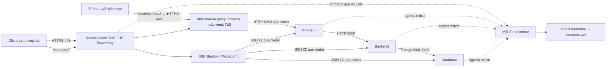

# Topology Docker — Frontend, Backend, DB, Reverse Proxy, SSH Jump Host và Zeek

Thiết kế hiện tại: **Web tách thành ba containers Frontend, Backend và DB; một reverse proxy, một SSH jump host, một router Alpine và một Zeek**. Có đúng 7 containers chạy thường trực. Client trong profile `test` chỉ tạo tạm để sinh traffic.

## Luồng kết nối



Proxy→Frontend và Bastion→các protected nodes đi qua router. Proxy kết thúc TLS. Frontend→Backend→DB dùng IP riêng cùng Protected subnet; host ACL kiểm soát các luồng này.

## Nodes và địa chỉ

| Mạng | Subnet | Nodes |
| --- | --- | --- |
| Outside | 172.30.10.0/24 | Client tạm .10, Router .254 |
| DMZ | 172.30.20.0/24 | Proxy .10, Bastion .20, Router .254 |
| Protected | 172.30.30.0/24 | Frontend .10, Backend .20, DB .30, Router .254 |
| Monitor | 172.30.99.0/24 | Router .10, Zeek .20, Frontend .31, Backend .32, DB .33 |

Outside/DMZ dùng bridge thường để traffic cross-subnet có thể tới router container; default routes trên client/proxy/bastion bị xóa và thay bằng routes lab. Protected/Monitor dùng internal bridges. Proxy publish `127.0.0.1:8443:443` để mở UI tại `https://localhost:8443/` trên máy Windows. Traffic trình duyệt vào Proxy trực tiếp qua Docker; dùng client lab để sinh metadata TLS đi qua Router mirror. Frontend, Backend và DB giữ cổng nội bộ.

## Các services

| Service | Cách dựng | Port / chức năng |
| --- | --- | --- |
| `router` | Build `docker/router`, Alpine | NET_ADMIN, IP forwarding, iptables NAT/ACL, tc mirror |
| `web-frontend` | Build target `frontend` trong `docker/web` | Nginx 8080 và SSH 22 |
| `backend` | Build target `backend` trong `docker/web` | Python API 8000 và SSH 22 |
| `db` | Build target `db` trong `docker/web` | PostgreSQL 5432 và SSH 22 |
| `proxy` | Build `docker/proxy`, Nginx | HTTPS 443, proxy_pass tới Frontend 8080 |
| `bastion` | Pull LinuxServer OpenSSH | SSH 2222, ProxyJump tới Frontend/Backend/DB:22 |
| `zeek` | Zeek 9.0.0 pinned, iproute2 + JA3/JA4/HASSH | Capture mirror0; conn/ssl/x509/ssh/notice/weird JSON theo field allowlist |

Mỗi protected node chỉ chạy dịch vụ của nó và SSH; supervisor dừng node nếu một daemon kết thúc. Frontend/API/DB chạy cửa hàng demo Nook: tìm/lọc sản phẩm, giỏ hàng và đặt đơn; sản phẩm, tồn kho và đơn nằm trong PostgreSQL. Không thanh toán thật, không thu thông tin cá nhân. Nội dung mua hàng không vào metadata dataset. Code/config được chia `docker/web/frontend`, `docker/web/backend`, `docker/web/db`; bootstrap/network/SSH chung nằm ở `docker/web/common`.

## Image SSH Jump Host

Compose pull trực tiếp:

```text
lscr.io/linuxserver/openssh-server:latest@sha256:46f115de7c251558297e7e87566fc3fc08544b63e55502b5cf294454db5d29d1
```

Không build image Bastion riêng. `docker/bastion/setup.sh` được mount vào custom init directory của image để thêm routes và cấu hình forwarding. Port mặc định giữ TCP 2222. Volume `/config` lưu host keys/config; public key nằm ở `/public/admin.pub`.

Cấu hình chính:

```text
PubkeyAuthentication yes
PasswordAuthentication no
PermitRootLogin no
AllowTcpForwarding local
PermitOpen 172.30.30.10:22 172.30.30.20:22 172.30.30.30:22
AllowAgentForwarding no
```

Client giữ private key; Bastion và ba nodes chỉ nhận public key. `scripts/start-lab.ps1` khởi tạo keys bằng container tạm rồi gỡ. `scripts/trust-lab-hosts.ps1` đọc public host keys qua Docker để cấp known_hosts. `ssh web-frontend`, `ssh backend`, `ssh db` tự dùng ProxyJump và kiểm tra host keys; `ssh web` là alias Frontend.

Tài liệu image: [LinuxServer OpenSSH](https://docs.linuxserver.io/images/docker-openssh-server/).

## Case TLS trên cùng một proxy

Biến `TLS_PROFILE` chọn `modern`, `weak`, `weak-cert`, `expired-cert`, `wrong-host` hoặc `replaced-cert`. Mỗi lần chỉ một profile chạy trên IP `172.30.20.10:443`; không có proxy thứ hai. Profiles/certificates được giữ riêng trong cùng image/volume. Đổi profile bằng `docker compose up -d --no-deps --wait proxy`, không cần rebuild. Xem [TLS_PROFILES.md](TLS_PROFILES.md) để kiểm tra từng điều kiện. Certificate tự ký baseline được test client tin/pin; replacement thay key/cert và phải được kiểm tra theo trust context, chưa tự chứng minh interception/MitM.

## NAT và ACL

| Nguồn | Đích | Cho phép |
| --- | --- | --- |
| Client .10 Outside | Proxy .10 DMZ | TCP 443 |
| Client .10 Outside | Bastion .20 DMZ | TCP 2222 |
| Proxy .10 DMZ | Frontend .10 Protected | TCP 8080 |
| Frontend .10 Protected | Backend .20 Protected | TCP 8000 |
| Backend .20 Protected | DB .30 Protected | TCP 5432 |
| Bastion .20 DMZ | Frontend/Backend/DB Protected | TCP 22 |
| Các flows trên | Chiều phản hồi | Established/related |

Router FORWARD mặc định DROP, chặn client truy cập trực tiếp protected nodes. Router SNAT Outside→DMZ và DMZ→Protected để đường phản hồi đi qua router; nó kiểm tra source gốc trước SNAT. Frontend và SSH servers thấy nguồn router Protected `.254` cho các flows routed; không thể suy ra client identity gốc chỉ từ IP này. Frontend→Backend→DB giữ IP nguồn thật.

Host INPUT/OUTPUT firewall trên ba nodes chỉ cho phép các application flows trong bảng và phản hồi. Chặn Frontend→DB trực tiếp, Backend→Frontend và truy cập application qua Monitor. DB pg_hba chỉ cho Backend IP kết nối vào fixture PostgreSQL; localhost dùng cho bảo trì trong container.

## Mirror và phạm vi Zeek

Một tunnel VXLAN VNI 42, UDP 4789, từ Router `.99.10` tới Zeek `.99.20`. Monitor MTU 1600, mirror0 MTU 1500.

- Router eth0 Outside mirror ingress/egress: TLS Client→Proxy và SSH Client→Bastion.
- Router eth2 Protected chỉ mirror egress: requests từ Proxy/Bastion vào protected nodes.
- Frontend/Backend/DB mirror egress eth0 Protected: responses và traffic nội bộ cùng subnet. Mỗi chiều có một bản sao; không mirror thêm ingress các nodes hoặc router Protected.
- Không mirror thêm DMZ để tránh ghi lại cùng các connections ở hai interface router.
- Zeek capture mirror0 trong namespace riêng; không nằm trên đường chuyển tiếp bắt buộc.

Zeek quan sát cả Frontend→Backend→DB từ node mirrors, dù traffic không đi qua router. Vẫn chỉ có một sensor, một log directory `data/lab_metadata/zeek/` và một output mặc định `data/lab_metadata/sessions.csv`; connection statistics không chứa HTTP/DB content.

Không PCAP persistence, TLS decryption hoặc L7 content logging trong pipeline. Mirror vẫn vận chuyển packet trong bộ nhớ; Zeek output giới hạn conn/ssl/x509/ssh metadata.

## Chạy và kiểm tra

```powershell
powershell -NoProfile -ExecutionPolicy Bypass -File .\scripts\start-lab.ps1
powershell -NoProfile -ExecutionPolicy Bypass -File .\tests\test_lab.ps1
python src/features/build_sessions.py
```

Test chỉ thêm client tạm, thử hai TLS profiles lần lượt trên cùng proxy, kiểm tra ProxyJump/ACL/metadata, khôi phục profile và gỡ client. Không cần vrnetlab hoặc router VM.
## Listener tạm cho custom attack dataset

Profile attack v3 dùng topology hiện có, không thêm container thường trực:
proxy TLS fixture `4443/4444`; bastion password/legacy SSH fixture `2223`;
Nmap probe proxy `4443,4450-4455` và backend/DB `22`. Router chỉ mở rule tạm
cho client lab và cleanup sau round. Cổng web 443 và bastion quản trị 2222
vẫn phục vụ background. Không publish thêm fixture port ra host Windows.
Chi tiết: [CUSTOM_DATASET_ATTACKS.md](CUSTOM_DATASET_ATTACKS.md).

